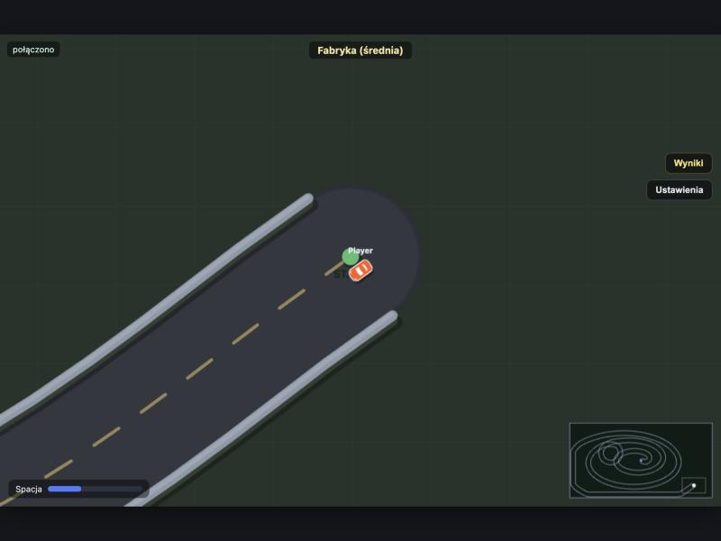
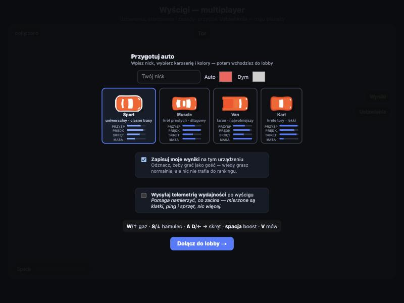
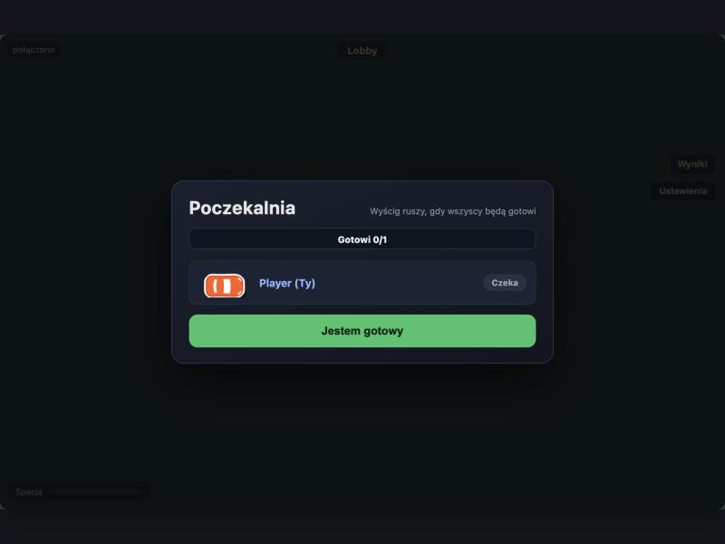

# Top-down multiplayer racing game

A browser-based real-time multiplayer racing game. The server is pure Python
(FastAPI + WebSocket); the client runs on a plain `<canvas>` — no game engine,
no frontend framework. Sprint from start to finish, first across the line wins.

> The in-game UI is in Polish (the game is played with friends); this README
> and all code documentation are in English.



```bash
python3 -m venv .venv
./.venv/bin/pip install -r requirements.txt
./run.sh                       # http://localhost:8000
```

---

## What makes this interesting

Three things that set this apart from a typical practice project:

### 1. A track generator that rejects its own output

Generating a maze is a textbook exercise. The hard part is verifying that a car
of non-zero radius can actually **drive through it** — across two levels, through
viaduct gates, without getting stuck in corners.

`track.py` generates candidates and **discards the ones that fail its validators**:

| validator | checks | why it exists |
|---|---|---|
| `reachable()` | BFS over a rasterized map, per floor, through gates | the finish was sometimes walled off |
| `centerline_ok()` | drives the track axis with a real car radius | the corridor was sometimes narrower than the car |
| `bridges_ok()` | rejects viaducts that cross each other | two bridges on one level blocked the path |
| `finish_clear()` | the entire approach to the finish must be open | the finish was sometimes walled off from its approach |
| `no_hairpins()` | whether a turn fits within the corridor width | a sharp turn folded the corridor onto itself |

The last one is the most interesting: for corridor width `w` and turn angle `θ`,
the segments on each side must be at least `(w/2)·tan(θ/2)` long — otherwise the
outer edge of the corridor self-intersects and a wall appears across the road.

### 2. Multi-level tracks

A track can cross over itself — one lane passing over another on a **viaduct**.
Every wall and every car carries a floor, and collisions are resolved per floor.
Entering and leaving a bridge happens through **gates**: segments that flip a car's
floor depending on its direction of travel.

### 3. Performance driven by measurement, not guesswork

Players reported ping spikes up to 1500 ms. A telemetry panel (FPS, ping, network
traffic) showed the spikes lined up with new track generation — 600–800 ms of CPU
work **inside the asyncio loop**, which served nobody during that time. Generation
was moved to a worker thread with a pre-filled pool:

| | before | after |
|---|---|---|
| **max ping** | 879 ms | **47 ms** |

A load harness (`harness-obciazenie.py`) runs N WebSocket bots concurrently and
measures the server. At 8 players the state-broadcast time stays under **2 ms p95** —
the bottleneck is bandwidth, not CPU:

| players | broadcast p95 | outbound |
|---|---|---|
| 8 | 1.87 ms | 120 kB/s |

---

## Architecture

```
server.py     WebSocket /ws, one room, round lifecycle (lobby -> drawing -> race)
track.py      track generators + drivability validators
db.py         SQLite: results, track archive, per-track records, telemetry
static/
  game.js     client: physics, networking, audio, voice chat, telemetry
  carart.js   car appearance (shared with tuner.html)
  index.html  UI
  tuner.html  dev tool for tuning car appearance
tests/        51 tests (pytest)
```

**Protocol.** A single WebSocket carries both game and voice. Text frames are JSON
(join, ready, position, finish); binary frames are raw PCM voice with the sender's
id prepended. Game state is broadcast 30 times per second; the client smooths other
cars' motion with an interpolation buffer that adapts to connection quality.

**Static vs dynamic state.** Constant per-player data (nickname, colour, body type)
is sent once in a `roster` message, not in every state packet. The state packet
carries only `{id, x, y, angle, level}` — this cut outbound traffic at 8 players
roughly in half.

**The server does not trust the client**, because the client runs its own physics:

- positions are validated (`NaN`/infinity rejected — otherwise they propagate into
  the broadcast packet and break distance math for every player) and clamped to the map
- finish claims are verified: the player must actually be inside the finish box, and
  the elapsed time cannot be shorter than physically possible for the start–finish
  distance at top speed
- message size and rate are limited per connection
- the audio-proxy endpoint resolves the target address before fetching and rejects
  private networks; all errors return an identical message so responses cannot be
  used to scan the local network

This is not a full anti-cheat (that would require server-side physics). It raises
the bar from "send one packet" to "write a bot that simulates a believable lap".

**Round lifecycle is stamped.** Each round gets a number and tasks from the previous
round are cancelled — otherwise a delayed task from an old race could end a new one,
a classic concurrency bug that is hard to reproduce and easy to miss.

---

## Gameplay



- **Lobby with ready-up** — the race starts when everyone clicks ready
- **Four vehicle classes** with different mass, grip, acceleration and gearing; the
  van shoves the kart aside, the kart wins in tight mazes. Balance was tuned with a
  physics-faithful benchmark, not by eye.
- **Draw your own track** with the mouse — it is validated exactly like a random one
- **Personal records per track** — the game remembers your best time on each track
- **Guest mode** — play without saving results; the ranking is keyed by a persistent
  browser id, not by nickname, so no one can claim your stats by typing your name
- **Three map sizes**: 4200×2400, 6800×3600, 9200×4800 pixels



### Controls

| key | action |
|---|---|
| **W** / ↑ | throttle |
| **S** / ↓ | brake and reverse (W+S together = hard brake) |
| **A** **D** / ← → | steer, proportional to speed |
| **Space** | nitro — empty at the start, charges from pads on the track |
| **V** | push-to-talk (configurable in settings) |

On a phone, touch controls appear automatically.

> **Note on audio:** engine and effect sounds are a work in progress and ship
> **disabled by default**. They can be enabled in settings.

---

## Tests

```bash
./.venv/bin/pip install -r requirements-dev.txt
./.venv/bin/pytest tests/ -v
```

51 tests. The validation tests guard bugs that actually occurred in this project —
if one starts failing, the bug came back. Examples:

- a track's `size` must be a **copy**, not a reference to a shared dictionary (that
  bug spawned players outside the map and froze the camera at the edge)
- `reachable()` must **reject** a walled-off finish — a validator that always says
  "yes" validates nothing
- a million drawn-map points must be truncated **before** conversion, not after

Tests run against a temporary database and never touch real results.

---

## Playing over the internet

The server listens on `0.0.0.0:8000`, so on a LAN the host's IP is enough. For
friends outside the network, a Cloudflare tunnel:

```bash
./run.sh        # server
./tunnel.sh     # public URL (random, changes on each run)
```

`tunnel-staly.sh` sets up a named tunnel with a **stable** address — it requires
your own domain attached to Cloudflare. Instructions are in the file's header.

---

## Tech stack

Python 3.13, FastAPI, uvicorn, SQLite, vanilla JavaScript, Canvas 2D, Web Audio,
WebSocket. No game engine, no frontend framework, no build step.

## Licence

Code: [MIT](LICENSE).
Vehicle sprites: [Kenney Racing Pack](https://kenney.nl/assets/racing-pack) — CC0.
Engine sound: [OpenGameArt racing loops](https://opengameart.org/content/racing-car-engine-sound-loops) — CC0.
